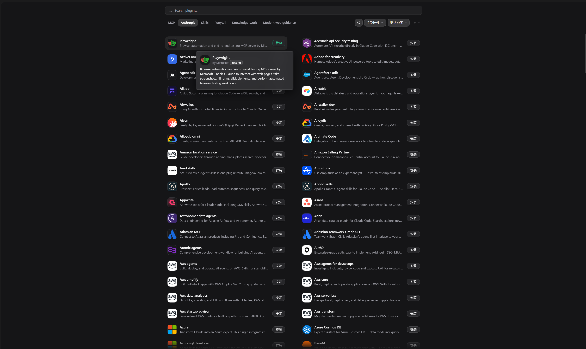
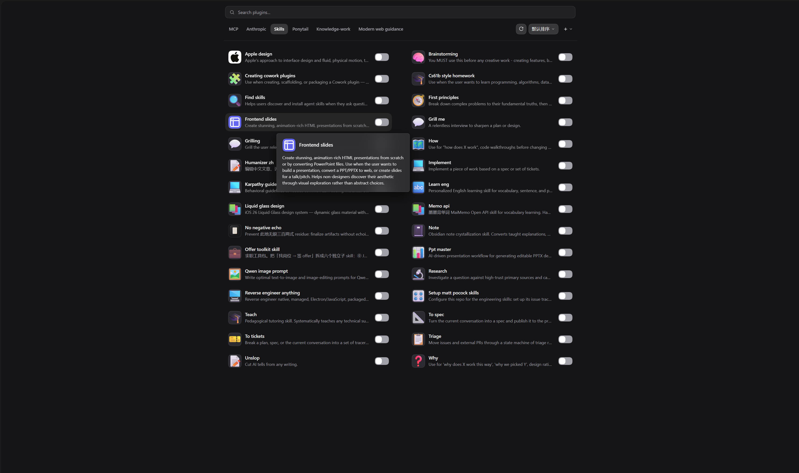
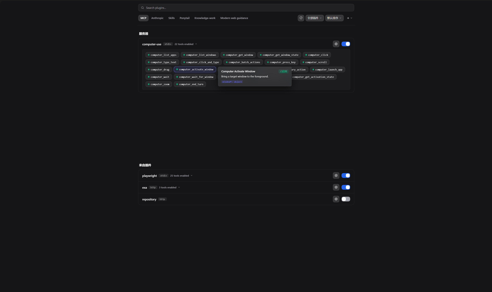
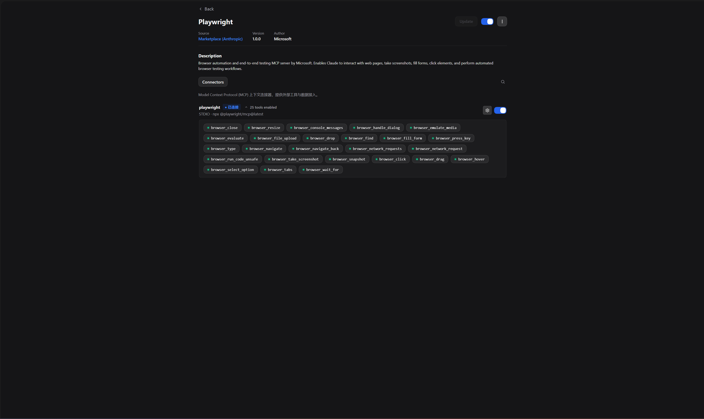
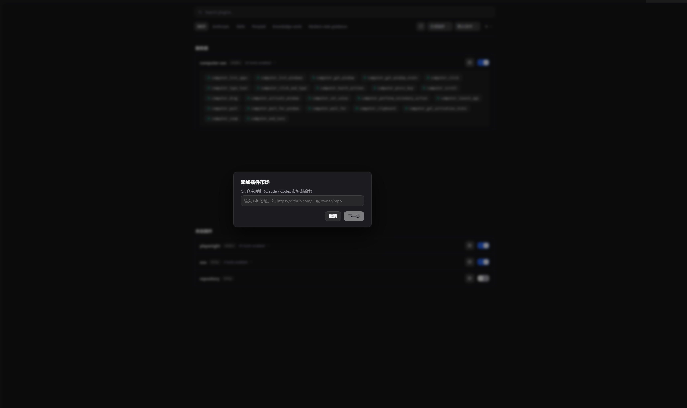

# Universal Plugin Hub

English | [简体中文](README.zh.md)

Use plugins from ecosystems such as Claude Code and Codex in DeepSeek Harness (DSH), and manage plugins, skills, and MCP in one place.

Universal Plugin Hub expands the plugin sources available to DSH. Browse the built-in official Claude catalog, install Claude Code and Codex plugins, add your own Git repositories as plugin sources, or upload plugins and skills for centralized browsing, installation, updates, and management. It also automatically scans your local skills directory, lets you enable or disable individual skills, and manages MCP servers, connection settings, and tool switches in the same interface.

After installation, the Hub recognizes a plugin's Skills, Commands, Agents, MCP, Hooks, and LSP configuration and converts or registers those capabilities with DSH. Skills and commands become available from the composer's `/` menu, subagents use DSH's delegation tool, and bundled MCP, Hooks, and LSP are managed with the plugin.

## Core features

### Bring plugin capabilities into DSH

| Plugin capability | How you use it in DSH |
| --- | --- |
| **Skills** | Synced to DSH's native skills directory and available from the composer's `/` menu, with scripts and resources in the skill directory preserved. |
| **Commands** | Markdown commands from Claude Code plugins are converted into DSH skills so you can use their workflows. |
| **Agents** | Subagent definitions become callable skills, with a delegation entry point that uses DSH's native `subagent` tool. |
| **MCP** | Connect plugin-declared MCP servers, configure service addresses, authentication, headers, and environment variables, then inspect tools and control which ones are enabled. |
| **Hooks** | Plugin hook configuration files are registered with DSH's hooks bridge and follow the plugin's enabled state. |
| **LSP** | Plugin-declared language servers are registered with DSH when their executables are available; missing executables are reported. |

### Discover, install, and manage plugins

- **Browse multiple marketplaces**: Start with the official Claude catalog (`anthropics/claude-plugins-official`), then add Claude or Codex marketplaces and Git repositories containing standalone plugins.
- **Upload plugins and skills**: Upload plugin or skill archives and individual `SKILL.md` files, or import from local directories and Git URLs. Skill collections can be parsed into individual skills, and plugin-declared MCP connectors are brought in with their plugins.
- **Automatically discover local skills**: Skills in `~/.agents/skills` appear in the **Skills** tab without importing them individually.
- **Toggle individual local skills**: Enable or disable skills from the list or detail page. Disabling a skill removes it from the DSH composer's `/` menu and prevents model invocation. Enabling it again restores its original invocation settings, with its files kept in place.
- **Manage the plugin lifecycle**: Installation, updates, enabling, disabling, and removal also manage the associated skills, MCP connectors, Hooks, and LSP registrations.
- **Manage MCP servers together**: Add your own MCP servers and view them alongside plugin connectors. Configure addresses, authentication, and environment variables, inspect tool lists, and control servers and individual tools.

## Interface preview

Icon cards show plugin descriptions and installation states, with source tabs, search, filters, and sorting to help you find what you need. The interface follows DSH's light and dark themes. Hover previews let you scroll descriptions and select text, while expanded MCP tools appear as compact status pills. Catalog and icon caching help content appear quickly on return visits.

**Official plugin catalog**: Browse official Claude plugins, search and preview descriptions, and install with one click.



**Local skills**: Automatically discover local skills, read their instructions, and enable or disable them individually.



**MCP management**: View your own servers alongside plugin connectors, inspect tool descriptions, and control servers and individual tools.



**Plugin details**: Review a plugin's source, version, and capabilities, and manage the plugin and its MCP connectors.



**Add plugin sources**: Add your own Git repositories to import Claude or Codex marketplaces and plugins.



## Installation

Supports DeepSeek Harness Desktop and the CLI web profile.

The declared minimum DSH host version is `0.1.5-rc.1`, the earliest official release candidate containing the desktop app.

### DeepSeek Harness Desktop

1. Open DeepSeek Harness.
2. Go to **Settings** -> **Plugins**.
3. Click **Add plugin** and enter the package name:

   ```text
   universal-plugin-hub
   ```

   You can also enter the repository URL:

   ```text
   https://github.com/Ultmebius/universal-plugin-hub.git
   ```

4. Click install.

### Command line

Run this in your terminal:

```bash
dsh plugin add universal-plugin-hub
```

## Usage

1. **Browse and install**: Search by name or keyword, choose a source, and click **Install** on a plugin card.
2. **Add a marketplace**: Open the **+** menu, choose **Add plugin marketplace**, and enter a Claude or Codex repository URL. Review the parsed content before adding it.
3. **Import plugins or skills**: Choose **Upload plugin** from the **+** menu. Enter a local path or Git URL, or select a supported file, then review the preview and confirm the import.
4. **Manage installed plugins**: Click **Manage** on an installed plugin to configure connectors, manage capabilities, update, or uninstall it.
5. **Use MCP tools**: Open the **MCP** tab to view servers and plugin connectors. Expand a server's tools to view their descriptions and control which tools are enabled.
6. **Manage local skills**: Once local skills are detected, open the **Skills** tab, click a skill to read its instructions, and use the switch in the list or detail page to enable or disable it. Refresh the list after adding, editing, or deleting skill files.

After installing a plugin with Skills or Commands, find its skills in the DSH composer's `/` menu. For a plugin with MCP connectors, open the **From plugins** group in the MCP tab to configure connections and inspect tools.

Local skill discovery follows DSH's native scope: it recognizes `~/.agents/skills/<name>/SKILL.md` and `~/.agents/skills/<name>.md`, without recursively scanning deeper directories. When `DSH_AGENTS_HOME` is set, it scans the `skills` directory under that location instead.

## Supported content

| Content | Recognized structure |
| --- | --- |
| Claude marketplace | `.claude-plugin/marketplace.json` |
| Codex marketplace | `.agents/plugins/marketplace.json` |
| Claude plugin | `.claude-plugin/plugin.json` |
| Codex plugin | `.codex-plugin/plugin.json` |
| Agent Skills | A `SKILL.md` file, a skill directory, or a collection of skill directories |

When a plugin or marketplace includes both Claude and Codex descriptors, the Claude format takes precedence.

File uploads accept `.zip`, `.tgz`, `.tar.gz`, and `SKILL.md`, up to 22 MB per upload. Larger archives can be extracted and imported through a directory path. Import the complete directory or archive for skills with scripts or other resources so relative paths remain usable.

## Data and directory layout

- **Hub installation**: `~/.dsh/profiles/desktop/node_modules/universal-plugin-hub`
- **Local skills scan directory**: `~/.agents/skills` (configurable through `DSH_AGENTS_HOME`)
- **Marketplace plugins**:
  - Installed plugin files: `~/.dsh/agent-skills/universal-plugin-hub/installed/<plugin-name>`
  - Cloned source cache: `~/.dsh/agent-skills/universal-plugin-hub/market/<source-id>`
  - State and source registry: `~/.dsh/agent-skills/universal-plugin-hub/state.json`
- **Runtime patch configuration**: `~/.dsh/profiles/<profile>/cordis.patch.yml`

`~/.dsh` is the default data directory. Paths follow `DSH_HOME` when it is configured.

## License

[MIT License](./LICENSE)
