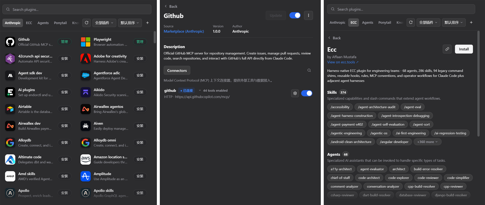

# Universal Plugin Hub

[English](README.md) | 简体中文

在 DeepSeek Harness（DSH）中安装和使用 Claude Code、Codex 生态的插件与技能。

Universal Plugin Hub 提供插件市场、安装管理和能力接入。添加插件源或导入插件后，它会识别其中的 Skills、Commands、Agents、MCP、Hooks 和 LSP 配置，将相应能力转换或注册到 DSH，供你在对话和任务中使用。

## 核心功能

### 将插件能力接入 DSH

| 插件能力 | 在 DSH 中如何使用 |
| --- | --- |
| **Skills 技能** | 同步到 DSH 的原生技能目录，在输入框的 `/` 菜单中调用；技能目录中的脚本和资源随技能一同保留。 |
| **Commands 命令** | 将 Claude Code 插件中的 Markdown 命令转换为 DSH 技能，继续使用这些命令所定义的工作流程。 |
| **Agents 子代理** | 将子代理定义转换为可调用的技能，并生成通过 DSH 原生 `subagent` 工具委派任务的入口。 |
| **MCP 工具** | 接入插件声明的 MCP 连接器，配置服务地址、鉴权、请求头和环境变量，查看工具能力并逐个控制启用状态。 |
| **Hooks 钩子** | 读取插件的 Hooks 配置文件，注册到 DSH 的钩子桥接服务，并随插件启停。 |
| **LSP 语言服务** | 读取插件声明的语言服务器配置，在服务器程序可用时注册到 DSH；缺少程序时提供相应提示。 |

### 从发现到管理插件

- **浏览多个插件市场**：内置 Claude 官方插件源（`anthropics/claude-plugins-official`），支持添加 Claude 与 Codex 插件市场，以及包含独立插件的 Git 仓库。
- **导入自己的插件和技能**：支持本地目录、Git 地址、压缩包和单个 `SKILL.md`；技能集合可以按独立技能解析和导入。
- **统一管理插件生命周期**：安装、更新、启用、停用和卸载插件时，同步处理对应的技能、MCP 连接器、Hooks 与 LSP 注册。
- **集中管理 MCP 服务器**：在同一页面查看手动添加的服务器与插件提供的连接器，编辑配置、展开工具列表，并管理单个工具的开关。

## 界面预览

插件以图标卡片展示，配合来源标签、搜索、筛选和排序，方便查找插件与查看安装状态。界面跟随 DSH 切换浅色和深色主题；插件及工具的悬停预览支持滚动阅读与文字选择，展开的 MCP 工具以状态标签排列。目录和图标缓存让再次浏览时能更快看到内容。



## 安装

支持 DeepSeek Harness 桌面端和命令行 Web profile。

### DeepSeek Harness 桌面端

1. 打开 DeepSeek Harness 客户端。
2. 进入**设置** -> **插件**。
3. 在安装输入框中粘贴仓库地址：
   ```text
   https://github.com/Ultmebius/universal-plugin-hub.git
   ```
4. 点击安装。

### 命令行安装

在终端执行：

```bash
dsh plugin add https://github.com/Ultmebius/universal-plugin-hub.git
```

## 使用方法

1. **浏览和安装**：按名称或关键词搜索，选择插件源，点击插件卡片上的 **安装**。
2. **添加插件市场**：打开 **+** 菜单，选择 **添加插件市场**，输入 Claude 或 Codex 仓库地址，查看解析结果后添加。
3. **导入插件或技能**：在 **+** 菜单选择 **上传插件**，填写本地路径或 Git 地址，或选择支持的文件，查看预览后确认导入。
4. **管理已安装插件**：点击插件卡片上的 **管理**，配置连接器、管理能力、更新或卸载插件。
5. **使用 MCP 工具**：进入 **MCP** 页查看服务器和插件连接器，展开服务器工具列表，查看工具说明并控制启用状态。

安装提供 Skills 或 Commands 的插件后，可以在 DSH 输入框的 `/` 菜单中找到相应技能。安装带有 MCP 的插件后，可以在 MCP 页的 **来自插件** 分组中配置连接器并查看工具。

## 支持的内容

| 内容 | 识别结构 |
| --- | --- |
| Claude 插件市场 | `.claude-plugin/marketplace.json` |
| Codex 插件市场 | `.agents/plugins/marketplace.json` |
| Claude 插件 | `.claude-plugin/plugin.json` |
| Codex 插件 | `.codex-plugin/plugin.json` |
| Agent Skills | `SKILL.md` 文件、技能目录或多个技能目录组成的集合 |

文件上传支持 `.zip`、`.tgz`、`.tar.gz` 和 `SKILL.md`，单次上传上限为 22 MB。较大的压缩包可以解压后通过目录路径导入。含脚本或其他资源的技能请导入完整目录或压缩包，以保留可用的相对路径。

## 本地数据与目录结构

- **Hub 插件本体**：`~/.dsh/profiles/desktop/node_modules/universal-plugin-hub`
- **市场内安装的插件**：
  - 插件安装目录：`~/.dsh/agent-skills/universal-plugin-hub/installed/<plugin-name>`
  - 插件源 Git 缓存：`~/.dsh/agent-skills/universal-plugin-hub/market/<source-id>`
  - 插件源与安装记录：`~/.dsh/agent-skills/universal-plugin-hub/state.json`
- **运行时配置补丁**：`~/.dsh/profiles/<profile>/cordis.patch.yml`

`~/.dsh` 为默认数据目录；设置 `DSH_HOME` 后，路径随该配置调整。

## 开源协议

[MIT License](./LICENSE)
